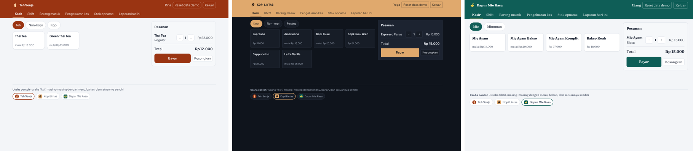
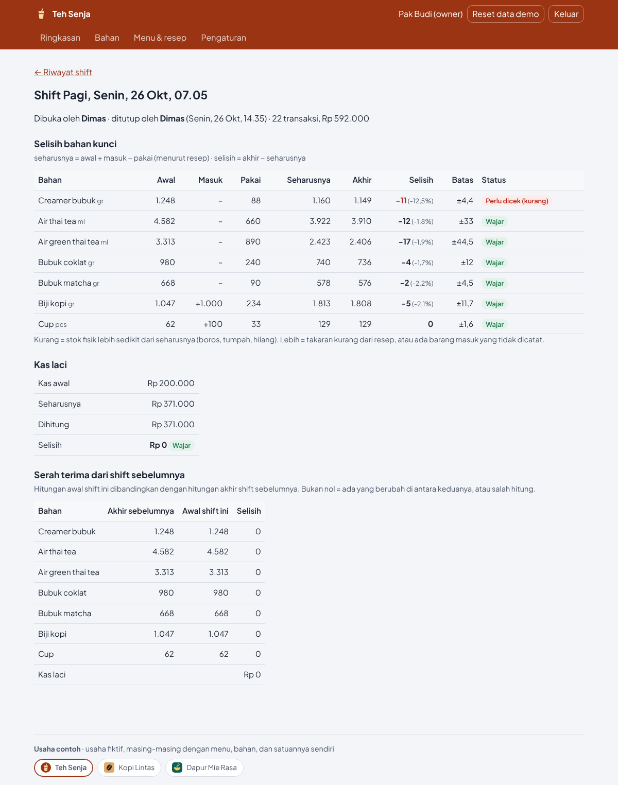
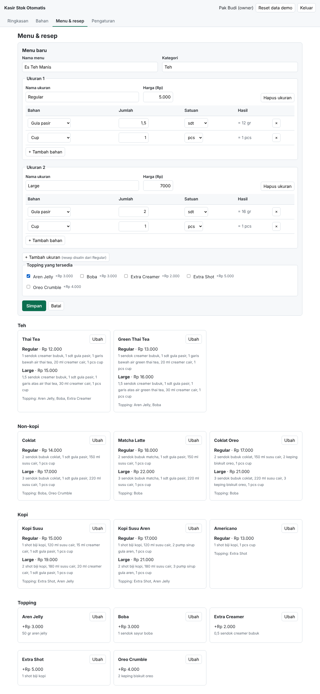

# Kasir Stok Otomatis

Web kasir untuk kedai minuman dan warung makan yang **mengurangi stok bahan otomatis sesuai resep, apa pun satuannya**: gram, ml, sendok, garis gelas, porsi, butir, atau pcs.

> **Demo:** _(tautan Vercel diisi setelah deploy)_ · data contoh di browser, tanpa login sungguhan · pilih nama untuk masuk



## Masalah yang diselesaikan

Di kedai, satu gelas thai tea memakai 1 sendok creamer (8 gr), 1 sdt gula (8 gr), air thai tea setinggi garis gelas, dan 20 ml creamer cair. Mencatat pemakaian itu satu per satu, dengan satuan yang berbeda-beda, sulit, terutama bagi pegawai baru.

Di aplikasi ini **crew tidak pernah menghitung satuan**. Owner menulis resep sekali ("1 sendok creamer" → tampil "= 8 gr"), crew cukup menekan menu, dan stok setiap bahan berkurang sendiri.

```
2 × Thai Tea Regular + Aren Jelly
  → resep menu + resep topping
  → satuan dasar: creamer 8 gr, gula 8 gr, air thai tea 150 ml, creamer cair 20 ml, aren jelly 50 gr
  → × 2, dijumlah per bahan
  → stok: creamer −16 gr, gula −16 gr, air thai tea −300 ml, creamer cair −40 ml, aren jelly −100 gr
```

## Fitur

**Crew** (kerja *all role*: kasir, bikin minuman, hitung stok)
- **Kasir**: menu per kategori, ukuran (Regular/Large, Panas/Dingin), topping, keranjang, bayar tunai dengan kembalian atau QRIS, struk.
- **Buka/tutup shift dengan hitung buta**: crew menghitung bahan kunci tanpa melihat angka sistem. Setiap pergantian shift menghasilkan hitungan oleh orang berbeda, jadi selisih bisa ditunjuk ke satu shift.
- Shift yang lupa ditutup tetap tercatat; kas laci dihitung saat buka dan tutup.

**Owner**
- **Detail shift**: `seharusnya = awal + masuk − pakai`, `selisih = akhir − seharusnya`, dengan status *wajar* / *perlu dicek* berdasarkan toleransi per bahan.
- **Bahan & satuan**: satuan dasar bebas, satuan bantu dengan konversi wajib (sendok, garis gelas, karung, panci), toleransi, saran toleransi dari riwayat 10+ shift.
- **Menu & resep**: resep per ukuran dengan hasil konversi langsung di setiap baris.



**Tiga usaha contoh** dengan tampilan (warna, huruf, tema terang/gelap) dan data 30 hari sendiri:

| Usaha | Contoh satuan |
|---|---|
| Teh Senja | sendok, garis gelas, teko, keping |
| Kopi Lintas | shot (18 gr), pump sirup, croissant per pcs |
| Dapur Mie Rasa | ayam per porsi, telur & bakso per butir, pangsit per lembar |



## Menjalankan

```bash
npm install
npm run dev      # http://localhost:5173
npm test         # vitest: logika, skema, mock, profil
npm run build    # hasil di dist/
```

Tanpa backend: data dibuat di browser (localStorage) saat pertama kali dibuka. "Reset data demo" di kepala halaman mengembalikan data contoh.

## Arsitektur

Frontend dibangun penuh; backend berupa rencana yang siap dieksekusi. Semua data lewat satu pintu (`frontend/src/api/klien.js`), dijawab mock sekarang dan backend asli nanti tanpa mengubah halaman.

```
logika/      fungsi murni: pemakaian, selisih shift, toleransi, kas   ← dipakai mock sekarang, backend nanti
skema/       zod untuk body request                                    ← dipakai mock sekarang, backend nanti
frontend/src/
  api/       klien.js (mock | real), mock/ (router, data demo, katalog per usaha)
  merek/     profil usaha → variabel CSS (cek kontras WCAG)
  halaman/   crew/ (kasir, shift), owner/ (ringkasan, detail shift, bahan, menu, pengaturan)
```

- Jumlah bahan disimpan sebagai bilangan bulat ×10 (kelipatan 0,1) supaya `0.1 + 0.2` tetap `0.3`.
- Transaksi menyimpan salinan pemakaian; mengubah resep tidak mengubah transaksi lama.
- Hitung buta dijaga di API, bukan hanya di tampilan: respons ke crew tidak pernah memuat angka stok.

Env dan deploy: [`docs/DEPLOY.md`](docs/DEPLOY.md).
